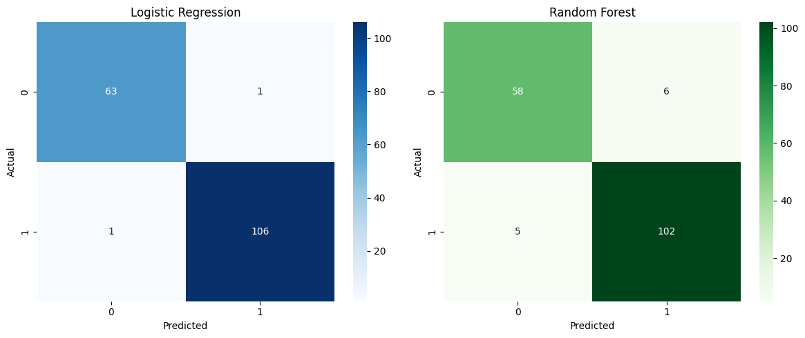
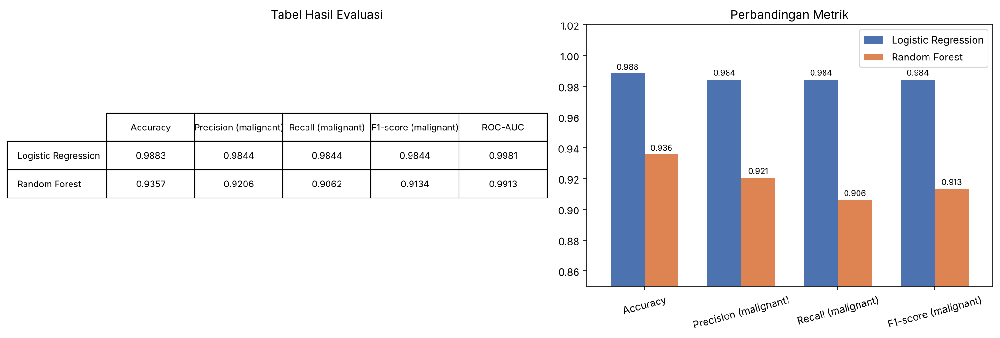

# Mini Assignment: Logistic Regression vs Random Forest (Klasifikasi Kanker)

## Identitas Mahasiswa
- Nama: Yulia Tasiyah
- NIM: B1C024027
- Kelas: [ISI KELAS]

## Deskripsi Eksperimen
Membandingkan algoritma **Logistic Regression** dan **Random Forest Classifier** untuk klasifikasi kanker payudara
menggunakan dataset *Breast Cancer Wisconsin (Diagnostic)* dari `sklearn.datasets.load_breast_cancer` (569 sampel, 30 fitur).

- Label: 0 = Malignant (ganas), 1 = Benign (jinak).
- Pembagian data: **70% training (398 sampel) dan 30% testing (171 sampel)**, `random_state=42`, `stratify=y`, sama untuk kedua algoritma.
- Data testing terdiri dari 64 sampel malignant dan 107 sampel benign.
- Logistic Regression memakai `StandardScaler` (pipeline, `max_iter=1000`); Random Forest memakai `n_estimators=100`.
- Precision, recall, dan F1-score dihitung untuk kelas **malignant**, karena tujuannya mendeteksi kanker.

## Perbandingan Accuracy, Precision, Recall, dan F1-score

| Algoritma | Accuracy | Precision (malignant) | Recall (malignant) | F1-score (malignant) | ROC-AUC |
|---|---|---|---|---|---|
| Logistic Regression | 0,9883 (98,83%) | 0,9844 | 0,9844 | 0,9844 | 0,9981 |
| Random Forest | 0,9357 (93,57%) | 0,9206 | 0,9062 | 0,9134 | 0,9913 |

## Confusion Matrix

Baris = kelas aktual, kolom = kelas prediksi.

**Logistic Regression**

| | Prediksi Malignant | Prediksi Benign |
|---|---|---|
| Aktual Malignant | 63 | 1 (FN) |
| Aktual Benign | 1 (FP) | 106 |

**Random Forest**

| | Prediksi Malignant | Prediksi Benign |
|---|---|---|
| Aktual Malignant | 58 | 6 (FN) |
| Aktual Benign | 5 (FP) | 102 |

Keterangan: kelas positif = malignant. FN = tumor ganas diprediksi jinak, FP = tumor jinak diprediksi ganas.

## Analisis: Algoritma Mana yang Lebih Baik?

**Logistic Regression memberikan hasil klasifikasi yang lebih baik** pada eksperimen ini. Accuracy-nya 98,83% dibanding 93,57% pada Random Forest. Logistic Regression hanya salah pada 2 dari 171 sampel (1 FN dan 1 FP), sedangkan Random Forest salah pada 11 sampel (6 FN dan 5 FP).

Logistic Regression juga lebih unggul pada semua metrik untuk kelas malignant: precision 0,984 (RF 0,921), recall 0,984 (RF 0,906), dan F1-score 0,984 (RF 0,913). Nilai ROC-AUC-nya juga lebih tinggi (0,9981 vs 0,9913), yang berarti kemampuan membedakan tumor ganas dan jinak sedikit lebih baik.

Dalam deteksi kanker, kesalahan yang paling berbahaya adalah *false negative*, yaitu tumor ganas yang diprediksi jinak, karena pasien tidak mendapat penanganan dini. Random Forest melewatkan 6 tumor ganas (recall 90,6%), sedangkan Logistic Regression hanya 1 (recall 98,4%). Perbedaan precision dan recall juga penting: precision menunjukkan seberapa dapat dipercaya prediksi "ganas", sedangkan recall menunjukkan seberapa banyak tumor ganas yang berhasil ditemukan. Pada kasus kanker, recall lebih diprioritaskan agar sedikit pasien yang terlewat.

Catatan: Random Forest umumnya kuat pada data kompleks, tetapi pada dataset ini fitur numerik sudah cukup terpisah secara linear sehingga Logistic Regression yang sederhana bekerja sangat baik. Hasil ini berlaku untuk satu kali pembagian data dengan `random_state=42` dan jumlah data testing 171 sampel, jadi bisa berubah jika pembagian data berbeda.

## Mengapa Evaluasi Tidak Cukup Hanya dengan Accuracy?

1. **Accuracy menganggap semua kesalahan sama.** FP dan FN dihitung setara, padahal dampak klinisnya sangat berbeda. Tumor ganas yang diprediksi jinak jauh lebih berbahaya daripada tumor jinak yang diprediksi ganas.
2. **Accuracy bisa menyesatkan pada data tidak seimbang.** Pada data medis, kasus kanker sering jauh lebih sedikit daripada kasus sehat. Model yang selalu menebak "jinak" bisa terlihat sangat akurat tanpa mendeteksi satu pun kanker. Pada dataset ini kelas sudah cukup seimbang (64 vs 107 pada data testing), tetapi prinsipnya tetap berlaku.
3. **Accuracy tidak menunjukkan jenis kesalahan.** Dua model dengan accuracy mirip bisa punya jumlah FN yang berbeda. Hal ini hanya terlihat dari confusion matrix dan recall.
4. **Metrik lain memberi gambaran lebih lengkap.** Precision menilai ketepatan prediksi ganas, recall menilai kemampuan menemukan semua tumor ganas, F1-score menyeimbangkan keduanya, dan ROC-AUC menilai kemampuan membedakan kedua kelas di berbagai threshold.

## Kesimpulan

- Dataset dibagi 70% training (398 sampel) dan 30% testing (171 sampel), sama untuk kedua algoritma.
- Logistic Regression lebih baik daripada Random Forest pada semua metrik: accuracy 98,83% vs 93,57%, F1-score malignant 0,984 vs 0,913, dan ROC-AUC 0,998 vs 0,991.
- Logistic Regression hanya melewatkan 1 tumor ganas (FN), sedangkan Random Forest melewatkan 6.
- Untuk deteksi kanker, recall dan jumlah false negative harus menjadi prioritas, sehingga Logistic Regression lebih disarankan pada eksperimen ini.
- Accuracy saja tidak cukup, evaluasi harus mencakup precision, recall, F1-score, confusion matrix, dan ROC-AUC.
- Model ini hanya untuk pembelajaran dan tidak menggantikan diagnosis medis profesional.
