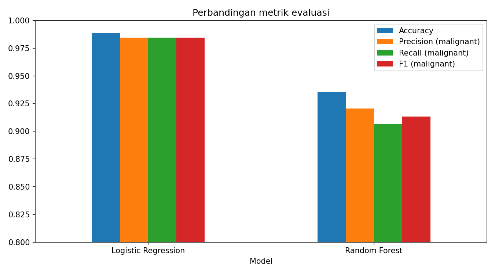
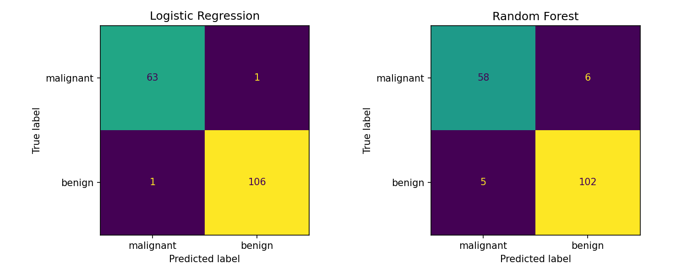

# Mini Assignment

- Nama: Najah Hanifah
- NIM: B1C024055
- Kelas: B

## Deskripsi Eksperimen
Klasifikasi tumor payudara (malignant vs benign) menggunakan dataset
`load_breast_cancer` dari scikit-learn. Dataset dibagi 70% training dan
30% testing (`test_size=0.30`, `random_state=42`, `stratify=y`), dengan
pembagian yang sama untuk kedua algoritma.

- Model 1: Logistic Regression (dengan StandardScaler)
- Model 2: Random Forest Classifier (100 pohon)

Kelas positif yang dievaluasi adalah **malignant** (ganas), karena kesalahan
mendeteksi kelas ini paling berbahaya. Jumlah data uji: 171 (64 malignant,
107 benign).

## Hasil Evaluasi

| Metrik                | Logistic Regression | Random Forest |
|-----------------------|---------------------|---------------|
| Accuracy              | 0.9883              | 0.9357        |
| Precision (malignant) | 0.9844              | 0.9206        |
| Recall (malignant)    | 0.9844              | 0.9062        |
| F1-score (malignant)  | 0.9844              | 0.9134        |

## Confusion Matrix

| Model               | TP (malignant benar) | FN (malignant salah) | FP (benign salah) | TN (benign benar) |
|---------------------|----------------------|----------------------|-------------------|-------------------|
| Logistic Regression | 63                   | 1                    | 1                 | 106               |
| Random Forest       | 58                   | 6                    | 5                 | 102               |

## Analisis
Pada eksperimen ini, Logistic Regression memberikan hasil klasifikasi yang
lebih baik daripada Random Forest di semua metrik. Logistic Regression hanya
melakukan 2 kesalahan dari 171 data uji (1 False Negative dan 1 False
Positive), sedangkan Random Forest melakukan 11 kesalahan (6 False Negative
dan 5 False Positive).

Perbedaan paling penting ada pada recall kelas malignant: 0.9844 untuk
Logistic Regression dan 0.9062 untuk Random Forest. Artinya Random Forest
melewatkan 6 pasien kanker (diprediksi jinak), sedangkan Logistic Regression
hanya melewatkan 1. Precision Logistic Regression juga lebih tinggi (0.9844
vs 0.9206), sehingga lebih sedikit pasien jinak yang salah dicurigai ganas.

Catatan: kesimpulan ini berlaku untuk satu kali pembagian data dan Random
Forest dengan parameter default, sehingga belum tentu berlaku umum untuk
semua pembagian data atau pengaturan hyperparameter lain.

## Mengapa Accuracy Tidak Cukup
Accuracy hanya menghitung proporsi prediksi yang benar dan tidak
membedakan jenis kesalahannya. Pada deteksi kanker, jenis kesalahan sangat
penting:

- **False Negative** (pasien kanker diprediksi sehat) sangat berbahaya karena
  pasien tidak mendapat penanganan. Ini diukur oleh **recall**.
- **False Positive** (pasien sehat diprediksi kanker) menyebabkan pemeriksaan
  lanjutan dan kecemasan yang tidak perlu. Ini diukur oleh **precision**.

Selain itu, data tidak seimbang (64 malignant vs 107 benign), sehingga
accuracy bisa tampak tinggi walaupun banyak kasus malignant terlewat. Karena
itu evaluasi perlu melihat precision, recall, F1-score, dan confusion matrix,
dengan penekanan khusus pada recall untuk kelas malignant.

## Kesimpulan
Logistic Regression lebih unggul pada eksperimen ini (accuracy 98,83%,
recall malignant 98,44%, hanya 1 False Negative), dibandingkan Random Forest
(accuracy 93,57%, recall malignant 90,62%, 6 False Negative). Untuk deteksi
kanker, recall yang tinggi sangat penting, sehingga Logistic Regression
dipilih sebagai model yang lebih baik pada eksperimen ini.
